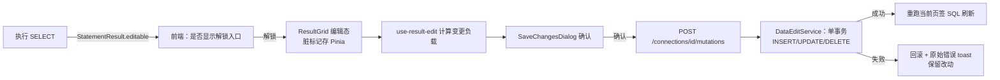

## 产品概述

实现 v0.4 F08「表数据编辑」：查询结果网格从只读升级为可编辑（PRD 第 37 行）。用户执行一条单表 SELECT 后，可在网格内直接改单元格、新增行、删除行，改动先本地暂存并打脏标记，点「保存」时弹确认框展示变更摘要，确认后后端**在一个事务里**按主键执行 INSERT / UPDATE / DELETE。范围按 2026-10-22 确认：**增删改全做**。

## 核心功能

- **编辑锁**：结果默认锁定（防误触），工具栏「解锁编辑」切换；仅可编辑的结果才显示该入口
- **可编辑判定**：仅单表查询（所有列来自同一张表）且结果包含全部主键列时可编辑；JOIN / 子查询 / 表达式列 / 无主键表 / 结果被截断 → 不可编辑并给出原因提示
- **网格内编辑**：双击进入编辑态（复用 Tabulator 现有 editor），主键列只读（禁止改主键定位值），改动单元格与行高亮标记
- **新增 / 删除行**：底部「新增行」追加空行（标记待插入）；选中行可「删除此行」（标记待删除，行置灰删除线）；删除已新增行则直接撤销
- **NULL 语义**：原 NULL 单元格显示为 `NULL`（沿用现有样式）；编辑态输入大写 `NULL` 关键字置为 NULL，空串保持空串；新增行未填列按列 nullable 处理
- **本地脏标记**：改动只存前端，翻页/切换结果页签不清空；「放弃改动」一键还原
- **保存确认**：「保存」仅在有改动时可用；点击弹确认框展示「INSERT n 条 / UPDATE n 条 / DELETE n 条」摘要，可展开查看将执行的语句；确认后提交，失败时保留改动并显示 MySQL 原始错误
- **保存后刷新**：成功后重跑当前页签 SQL 刷新结果，toast 提示影响行数
- **二进制列**：BLOB / BINARY 等列不可编辑（沿用现有 `(BLOB)` 展示）

## 视觉与交互效果

结果面板顶部新增一行紧凑编辑工具栏（锁定态只显示状态与「解锁编辑」；解锁态显示新增行 / 删除行 / 保存 / 放弃）；脏单元格浅黄底、待删除行淡红底加删除线、新增行左侧蓝色标记条；确认弹窗为项目既有 BaseDialog 风格，摘要用三色标签区分增/改/删。整体沿用 Joyo 现有紧凑专业桌面端风格，不引入新配色。

## 技术栈（沿用项目现状，不新增技术）

- 后端：Java 21 + Spring Boot 3（Sidecar）+ JDBC + HikariCP（max=5）+ Log4j2；单测 JUnit 5 + Mockito
- 前端：Vue 3 + TypeScript + Pinia + Tabulator（网格，现有虚拟滚动）+ Element Plus（工具栏/弹窗）；单测 Vitest
- desktop：**无改动**（本功能纯前端 ↔ 后端 HTTP，不经 IPC）
- 数据访问：元数据一律 `information_schema` + `PreparedStatement` 参数绑定（**禁用 DatabaseMetaData**，coding-backend.md 第 4 节硬约定）

## 实现方案

### 关键决策（含权衡）

1. **可编辑性判定放后端查询时完成**：`QueryService.executeSelect` 用 `ResultSetMetaData.getTableName(i)`（非 DatabaseMetaData，不违反约定）判定所有列是否来自同一张表；主键列用 `information_schema.COLUMNS`（`COLUMN_KEY='PRI'`）查询。结果随 `StatementResult` 附带 `editable: { schema, table, primaryKey: [...] } | null`。

- 权衡：不引入 JSqlParser 等 SQL 解析依赖（避免新依赖与解析不准）；前端零判定逻辑，规则单点可信。

2. **主键列必须出现在结果列中**，否则不可编辑（提示「请在 SELECT 中包含主键列」）。理由：无主键值无法生成 WHERE，自动补列会改变用户 SQL 语义。
3. **主键列不可编辑**：改主键 = 删除 + 新增，避免 UPDATE 定位歧义。
4. **语句在后端生成 + PreparedStatement 参数化**：`UPDATE t SET c=? WHERE pk=? AND c=?`、`DELETE`、`INSERT` 全参数绑定，标识符（表名/列名）经 `SqlIdentifiers.quote` 反引号转义；**不拼接值**。
5. **一个请求一个事务**：`conn.setAutoCommit(false)` → 全部成功 commit；任一条失败 rollback 并返回该条 MySQL 原始错误（4xxx 码）。避免部分成功造成数据不一致。
6. **`StatementResult` 新增 `editable` 字段**：需同步更新所有构造调用点（`QueryService` 2 处、`QueryControllerTest` 等），这是本次主要回归风险点，先用 [subagent:lsp-code-analysis] 列出全部引用再改。
7. **结果与编辑态的解耦**：缓存行是 `String[]`（后端全量缓存，默认上限 maxRows=1000），前端按「全局行号 = (page-1)*pageSize + 页内序号」记录脏数据，翻页不丢改动；不改动后端缓存结构。

### 数据流



### 复杂度与性能

- 可编辑判定：查询时 O(列数)，主键一次 `information_schema` 查询（可按 schema+table 短缓存，本期不做缓存，保持简单）
- 保存：N 条变更 → N 次参数化执行（单事务），N 受当前结果行数（≤ maxRows）限制，规模极小
- 前端脏标记：Map 按行号索引，O(1) 读写；变更摘要 O(改动数)

## 实现备注（防回归）

- 后端新增错误码放 4xxx 段：4101 结果不可编辑、4102 数据变更执行失败（message 为 MySQL 原始信息）、4103 主键列不可修改；未捕获异常仍走 1500（细节写日志不回前端）
- 所有 SQL 用 try-with-resources；事务必须显式 rollback（`catch` 中 rollback 后再抛）
- 前端 `ResultGrid.vue` 现有 `cellEdited` 会**还原原值**（只读语义），解锁后才允许提交新值并实现脏标记，注意保留只读路径不变
- `use-result-grid.ts` 的 `toGridRows` 生成 `c0..cN` 字段，新增行/删除行需保证字段数与列数对齐
- 文案全部进 `locales/zh-CN.ts` 新增 `edit` 段；类型进 `types/api.d.ts`
- desktop 无改动，但三端验证命令仍需全跑：`mvn -q test`；`pnpm.cmd test` + `build`；`pnpm.cmd typecheck` + `test` + `build`
- 提交在用户本地代理（127.0.0.1:7897）未启动时 push 会失败，属已知用户侧问题，本地 commit 照做并明确告知

## 架构设计

后端新增 `DataEditService`（判定 + 生成 + 事务执行）+ `DataEditController`（`/mutations`），复用 `ConnectionService.requireDataSource` 与 `SqlIdentifiers`；`QueryService` 仅增加可编辑性附带信息。前端新增 `use-result-edit.ts`（纯逻辑可测）+ `SaveChangesDialog.vue`，改造 `ResultGrid.vue` / `ResultPanel.vue`，Pinia `query` store 增加编辑态。层次与现有 spec-04/spec-15 一致，不引入新架构模式。

## 目录结构

```
docs/
├── 20-specs/
│   └── 16-data-edit.md              # [NEW] spec-16 规格（先写后实现，格式对齐 spec-template.md 与 15-export.md）
├── 30-api/
│   └── rest-api.md                  # [MODIFY] 正式登记 POST /connections/{id}/mutations；/queries 响应增加 editable 字段说明
└── (根目录) progress.md / docs/00-product/roadmap.md  # [MODIFY] v0.4 状态与进度记录

backend/src/main/java/com/joyo/backend/
├── model/
│   ├── MutationModels.java          # [NEW] EditableInfo(schema,table,primaryKey)、MutationRequest(database,table,primaryKey,operations)、MutationResponse(applied,results)、RowChange(type,pk,values)
│   └── QueryModels.java             # [MODIFY] StatementResult 增加 editable 组件（同步所有构造调用点）
├── service/
│   ├── EditableResolver.java        # [NEW] 单表判定（ResultSetMetaData.getTableName）+ 主键查询（information_schema）
│   ├── DataEditService.java         # [NEW] 校验可编辑性 → 单事务执行 INSERT/UPDATE/DELETE（PreparedStatement 参数绑定）
│   └── QueryService.java            # [MODIFY] executeSelect 附带 editable 信息
├── controller/
│   └── DataEditController.java      # [NEW] POST /api/v1/connections/{connectionId}/mutations
└── exception/ErrorCode.java          # [MODIFY] 新增 4xxx：4101/4102/4103

backend/src/test/java/com/joyo/backend/
├── service/DataEditServiceTest.java     # [NEW] 判定逻辑、SQL/参数生成（Mockito mock Connection/PreparedStatement）、失败回滚
└── controller/DataEditControllerTest.java # [NEW] 参数校验与错误码

frontend/src/
├── composables/
│   ├── use-result-edit.ts           # [NEW] 纯逻辑：脏标记结构、变更摘要统计、生成变更负载、NULL 语义
│   └── use-result-edit.test.ts      # [NEW] Vitest：新增/修改/删除/NULL/翻页保留
├── components/result/
│   ├── ResultGrid.vue               # [MODIFY] editable prop、解锁后提交编辑、脏样式、新增行/删除行、主键列只读
│   ├── ResultEditToolbar.vue        # [NEW] 解锁/新增行/删除行/保存/放弃 + 改动计数
│   └── SaveChangesDialog.vue        # [NEW] 变更摘要确认弹窗（可展开查看语句）
├── components/query/ResultPanel.vue  # [MODIFY] 挂载编辑工具栏与确认弹窗，传递 editable
├── api/mutations.ts                  # [NEW] applyMutations 请求封装（走现有 http.ts request）
├── stores/query.ts                    # [MODIFY] 编辑态与 pendingChanges、applyMutations action、保存后重跑 SQL
├── types/api.d.ts                    # [MODIFY] EditableInfo / MutationRequest / MutationResponse 类型
└── locales/zh-CN.ts                   # [MODIFY] 新增 edit 文案段
```

## 关键代码结构

```java
// 查询结果附带的可编辑信息（null = 不可编辑，前端隐藏编辑入口）
public record EditableInfo(String schema, String table, List<String> primaryKey) {}

// 批量变更请求：operations 按提交顺序执行，整体一个事务
public record MutationRequest(String database, String table, List<String> primaryKey,
                              List<RowChange> operations) {}

// 单行变更：UPDATE 用 values(列名→新值) + pk(主键列名→原值)；DELETE 仅 pk；INSERT 仅 values
public record RowChange(String type, Map<String, String> pk, Map<String, String> values) {}
```

```ts
// 前端脏标记（按全局行号索引，翻页不丢）
export type ChangeKind = 'insert' | 'update' | 'delete'
export interface RowChange { kind: ChangeKind; rowIndex: number; values?: (string | null)[] }
export interface EditState { unlocked: boolean; changes: Map<number, RowChange>; nextInsertSeq: number }
// 纯函数：摘要统计与负载生成（可单测）
export function summarize(state: EditState): { insert: number; update: number; delete: number }
export function buildPayload(state: EditState, columns: ColumnMeta[], editable: EditableInfo, rows: (string | null)[][]): MutationRequest
```

## 设计风格

沿用 Joyo 现有紧凑专业桌面端数据工具风格（对标 SQLyog）：纯白网格底、浅灰表头、1px 分割线、12-13px 字号、无圆角装饰，强调"信息密度 + 状态可辨"。编辑态通过**颜色状态**而非弹窗表达：脏单元格浅黄底、待删除行淡红底加删除线、新增行左侧 3px 蓝色标记条；所有状态在 hover 时有 tooltip 说明。微交互克制：解锁按钮切换有图标旋转过渡，保存按钮在改动出现时才从禁用态点亮（避免误触），确认弹窗淡入 150ms。

## 页面/区块设计

1. **编辑工具栏（新增）**：结果面板顶部、状态条下方一行；左＝锁图标 + 「已锁定/编辑中」状态 + 改动计数徽标；右＝「新增行」「删除行」「保存」「放弃」（锁定态仅显示「解锁编辑」与不可编辑原因 tooltip）。高度 32px，按钮为 Element Plus small + text 型，与现有 SQL 工具栏视觉一致。
2. **网格编辑区（改造）**：沿用 Tabulator 虚拟滚动与列宽拖拽；双击进编辑态（解锁后提交新值）；主键列表头带小锁图标且不可编辑；BLOB 列不可编辑；新增行追加在末尾并自动滚动定位。
3. **保存确认弹窗（新增）**：BaseDialog 420-480px；顶部三色摘要标签「INSERT 2 / UPDATE 1 / DELETE 1」；中部可折叠"查看语句"代码区（等宽字体、逐条列出将执行的 SQL）；底部「取消」「确认保存」（危险色强调）；不可编辑或主键缺失时禁用确认。
4. **结果状态条（沿用）**：分页与耗时信息不变，仅在有改动时右侧追加"未保存改动"提示。

## 响应式与一致性

桌面端固定布局（Electron 窗口），工具栏在空间不足时优先隐藏「放弃」「删除行」文字只留图标；配色与字体完全沿用 `frontend/src/styles/main.css` 的 `--joyo-*` 变量，不新增主题色。

## Agent Extensions

### SubAgent

- **code-explorer**
- Purpose：实现前核实 `StatementResult` 构造的全部调用点、`ResultGrid` 编辑相关 Tabulator 事件、`isBinaryType` 等工具函数位置，避免漏改与误改
- Expected outcome：给出绝对路径 + 行号的完整调用点清单，作为改造前的事实基线
- **lsp-code-analysis**
- Purpose：对 `StatementResult`（后端 record）与 `ResultTab`/`StatementResult`（前端类型）做引用/定义分析，圈定新增 `editable` 字段的影响面
- Expected outcome：确认所有需同步修改的构造点与类型引用，防止编译回归