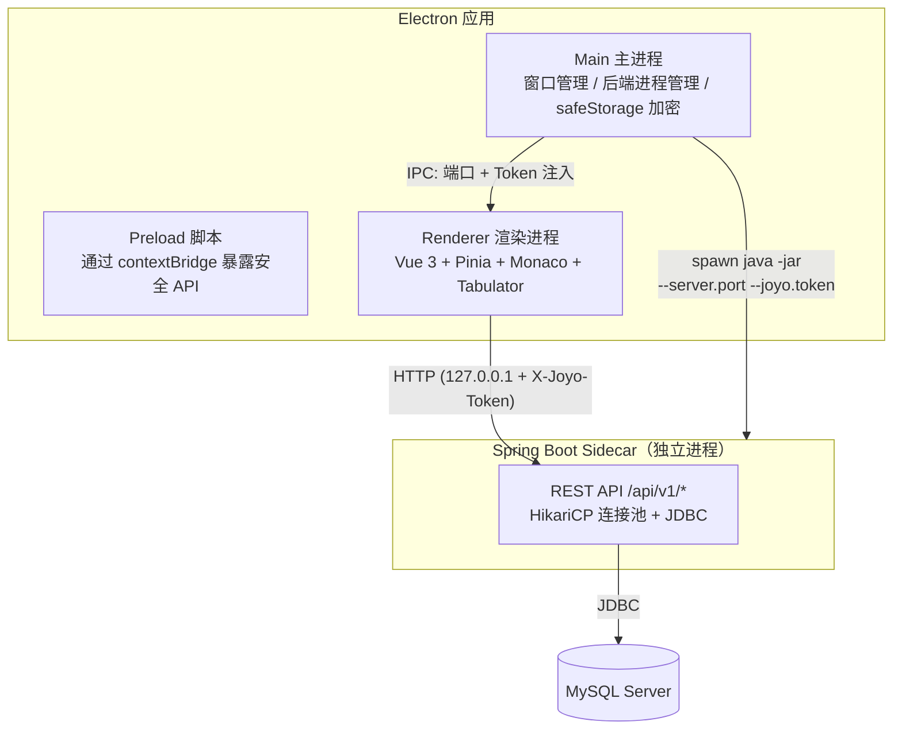

# Joyo 整体架构

> 文档状态：已定稿 | 上游文档：`docs/00-product/PRD.md`、`adr/001-tech-stack.md`
> 下游文档：`data-model.md`、`docs/30-api/rest-api.md`、`docs/20-specs/*`

## 1. 架构总览

采用 **Electron 桌面壳 + Spring Boot Sidecar 进程**架构：



### 关键组件职责

| 组件 | 职责 | 禁止做的事 |
|---|---|---|
| Electron Main | 拉起/监控/杀掉 Java 进程；读取空闲端口；生成随机 Token；用 safeStorage 加解密密码；窗口生命周期 | 不做业务逻辑 |
| Preload | 只通过 `contextBridge` 暴露白名单 API（读取端口与 Token、加解密密码、窗口控制），开启 `contextIsolation` | 不暴露 nodeIntegration |
| Renderer (Vue) | 全部界面与交互；通过 HTTP 调用后端 | 不直接访问文件系统/网络之外的 Node 能力 |
| Spring Boot | 全部数据库相关逻辑：连接池、元数据读取、SQL 执行、结果缓存 | 只监听 127.0.0.1；除健康检查外全部接口要求 Token |

## 2. Sidecar 进程生命周期（核心机制）

```
应用启动
  ├─ 1. Main 扫描空闲端口 P，生成随机 Token T
  ├─ 2. spawn: java -jar backend/bin/joyo-backend.jar --server.port=P --joyo.token=T
  │      （优先使用应用内置 JRE：backend-runtime/bin/java，找不到则回退系统 java）
  ├─ 3. 轮询 GET http://127.0.0.1:P/api/v1/health（间隔 500ms，总超时 30s）
  ├─ 4. 就绪后创建 BrowserWindow，Preload 注入 { baseUrl, token }
  └─ 5. 窗口加载 Vue 应用，开始正常工作

应用退出 / 后端崩溃
  ├─ 退出：Main 调用 tree-kill 杀掉进程树 → app.quit()（before-quit 钩子）
  ├─ 崩溃：托盘提示"后端服务异常"，提供"重启后端"按钮，重新执行步骤 1-4
  └─ 兜底：后端注册 shutdown hook；Main 监听 child 事件，确保无孤儿进程
```

**注意**：开发模式下后端由开发者手动启动（`mvn spring-boot:run -Dspring-boot.run.arguments=--server.port=18080 --joyo.token=dev`），Electron 检测到环境变量 `JOYO_DEV_BACKEND_URL` 时直接连接，不 spawn 进程。

## 3. 代码仓库结构（Monorepo）

```
joyo/
├── CLAUDE.md              # AI 开发总入口（必读）
├── progress.md            # 跨会话进度记忆
├── docs/                  # 全部文档（本目录）
│   └── private/           # 私有笔记（.gitignore，不入库）
├── frontend/              # Vue 3 渲染层（Vite + TS + Pinia）
│   ├── src/
│   │   ├── api/           # 后端接口封装（fetch 包装）
│   │   ├── components/    # 通用组件
│   │   ├── views/         # 页面级组件
│   │   ├── stores/        # Pinia 状态
│   │   ├── composables/   # 组合式函数
│   │   └── types/         # 与后端契约对应的 TS 类型
│   └── package.json
├── desktop/               # Electron 主进程 + preload（TS）
│   ├── src/main/          # 主进程：窗口、sidecar 管理、safeStorage
│   ├── src/preload/
│   └── package.json
├── backend/               # Spring Boot 3（Java 21，Maven）
│   ├── src/main/java/com/joyo/backend/
│   │   ├── controller/    # REST 接口层
│   │   ├── service/       # 业务逻辑层
│   │   ├── model/         # DTO（XxxRequest / XxxResponse）
│   │   ├── config/        # 配置类（Token 过滤器、全局异常等）
│   │   └── exception/     # 业务异常与错误码
│   └── pom.xml
├── scripts/               # 打包脚本（jlink 裁剪 JRE、组装安装包）
└── package.json           # 根工作区脚本（dev / build / package）
```

## 4. 安全模型

1. **网络层**：后端绑定 `127.0.0.1`；每次启动生成随机 Token，所有接口（含健康检查）要求请求头 `X-Joyo-Token`，防止本机其他进程未授权调用
2. **密码存储**：明文密码只存在于 Renderer 输入框 → 经 IPC 交给 Main 用 `safeStorage.encryptString` 加密 → 密文（`enc:v1:<base64>`）写入连接配置文件；解密只在 Main 进程发生，经 IPC 返回 Renderer 后仅用于填充表单
3. **后端不落盘**：后端不持久化任何密码；连接信息由前端在请求中传入（密码密文经 Main 解密后随请求体传输，仅走 localhost 回环）
4. **渲染进程隔离**：`contextIsolation: true`，`nodeIntegration: false`，`sandbox: true`

## 5. 打包与分发

| 步骤 | 工具 | 产物 |
|---|---|---|
| 1. 前端构建 | `vite build` | `frontend/dist` |
| 2. 后端构建 | `mvn package` | `joyo-backend.jar` |
| 3. JRE 裁剪 | `jlink`（基于 jdeps 分析依赖模块） | `backend-runtime/`（约 40-60MB） |
| 4. 组装 | `electron-builder`（nsis 目标） | `Joyo-Setup-x.y.z.exe` |

产物目录约定：安装包内 `resources/bin/joyo-backend.jar` 与 `resources/backend-runtime/` 与本文档第 2 节的 spawn 路径对应。

## 6. 技术栈版本约定

| 项 | 版本 |
|---|---|
| Java | 21（LTS） |
| Spring Boot | 3.3+ |
| MySQL 驱动 | com.mysql:mysql-connector-j（最新稳定版） |
| 连接池 | HikariCP（Spring Boot 默认，按连接动态建池） |
| Electron / Vue / Vite | 各自最新稳定版（大版本升级需更新本表并记入 progress.md） |
| 编辑器 / 网格 | monaco-editor / tabulator（均为 MIT 协议） |
